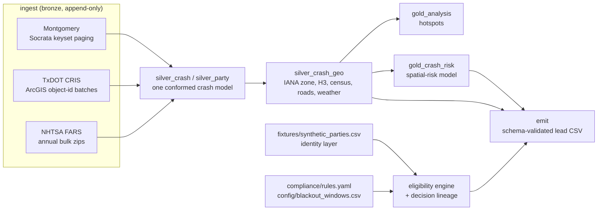

# Crash-to-Contact

A compliance-gated geospatial lead pipeline over three public motor-vehicle-crash sources.

It ingests Montgomery County MD (Socrata), TxDOT CRIS (ArcGIS) and NHTSA FARS (bulk CSV),
conforms them to one crash model, enriches them geospatially, applies a versioned eligibility
ruleset, scores the survivors, and emits records that conform to
`contracts/lead_output.schema.json`.

**The headline result is in [`MEMO.md`](MEMO.md): zero leads are lawfully contactable by live
outbound telephone in any of the three jurisdictions.** `output/sample_leads.csv` is
therefore a header row with no data rows. That is the pipeline's honest output, not a
failure to run it. The same records evaluated for the written channel produce 29 rows in
`output/sample_leads_written.csv`.

---

## How it fits together



Three choices shape the code more than any other:

- **Rules are data.** No statute, waiting period or calling window is written in Python. They
  live in `compliance/rules.yaml` and `config/blackout_windows.csv`, and every decision records
  the ruleset version that made it. Adding a new state's 45-day window is a CSV row.
- **Eligibility is proven, never assumed.** Every record starts INELIGIBLE, every gate
  accumulates all of its reason codes rather than stopping at the first, and each decision
  writes an append-only lineage row with a digest of the inputs it saw.
- **Location comes from coordinates.** The calling window is computed in the IANA zone at the
  party's coordinates. The area code is only a fallback and a cross-check: when the two
  disagree, the window shrinks to the hours that are lawful in both zones.

---

## Setup

Requires Python 3.12 (pinned in `.python-version`). No API keys are needed.

```bash
python -m venv .venv && source .venv/bin/activate
pip install -r requirements.txt
cp config/settings.example.toml config/settings.toml
```

`config/settings.toml` is gitignored. The only value that matters locally is the HMAC key used
to tokenise phone numbers, and the example's placeholder works for local runs. Census ACS is
deliberately not used (see [`DECISIONS.md`](DECISIONS.md) 3.1), so no Census key is needed.

`requirements.in` lists the direct dependencies; `requirements.txt` is the resolved lockfile.

Or with Docker, which needs nothing else installed:

```bash
docker build -t crash-to-contact .
docker run --rm crash-to-contact                                    # live-telephone evaluation
docker run --rm crash-to-contact python -m pytest tests/ -q -m "not slow"
```

---

## Offline demo (under a minute)

The compliance engine runs against the synthetic party fixture with no network and no
warehouse build. These commands are the ones verified in a fresh container.

```bash
python -m src.compliance.evaluate --no-persist
```

```
  ruleset 1.1.0 · channel live_telephone · as of 2026-09-01

    ELIGIBLE           0
    BLOCKED_UNTIL      0
    INELIGIBLE        40

  exclusion table (Part 7 asks for this one, not the inclusion table):

     40  LIVE_SOLICITATION_PROHIBITED
     28  MD_MVA_TELEPHONE_SOLICITATION_BAR
      6  TX_BARRATRY_FELONY
      3  DPPA_NO_PERMISSIBLE_USE
      3  CONSENT_ABSENT
      2  CONSENT_REVOKED
      2  DNC_LISTED
      2  FL_CRASH_REPORT_60D
      1  LINE_TYPE_UNRESOLVED
      1  RND_NO_DATA_NO_SAFE_HARBOR
      1  RND_REASSIGNED
      1  DNC_SCRUB_STALE
```

Every record is blocked by the categorical live-solicitation bar on its own, and most are
blocked several times over. The written channel removes that bar:

```bash
python -m src.compliance.emit --channel written
```

```
  ruleset 1.1.0 · channel written
    evaluated           40
      eligible now      25
      blocked until      4  (in the feed, not callable yet)
      ineligible        11  (withheld from the feed)
    written to file     29  -> output/sample_leads_written.csv
```

One emitted row, abridged (the CSV flattens the contract's nested groups with dots):

| field | value |
|---|---|
| `lead_id` | `lead-P001` |
| `jurisdiction` / `geo.zip5` | `MD` / `20850` |
| `geo.h3_r8` | `882aa84163fffff` |
| `geo.iana_timezone` | `America/New_York` |
| `contact.calling_window_local` | `08:00`–`21:00`, `address_coordinates` |
| `eligibility_status` | `ELIGIBLE` (`ELIGIBLE_CONSENTED`) |
| `priority_score` | `0.323517` = severity 0.0 + recency 0.273517 + spatial_risk 0.0 + data_quality 0.05 |

Without the TIGER and OSM caches the census and road columns are null rather than guessed; the
committed `output/` files were produced after the full pipeline and carry them. Phone tokens
depend on the HMAC key, so they differ between machines.

---

## Quickstart with live data (~5 minutes)

This ingests a bounded slice from the three public sources, builds every derived layer the
compliance step needs, and emits the lead feed.

```bash
# 1. Ingest all three sources         (~4m30s)
python -m src.ingest.montgomery --dataset all
python -m src.ingest.txdot
python -m src.ingest.fars

# 2. Conform and enrich               (~12s)
python -m src.transform.silver
python -m src.geo.enrich

# 3. Decide and emit                  (~2s)
python -m src.compliance.evaluate
python -m src.compliance.emit

# 4. Verify
python -m pytest tests/ -q
```

At step 3 the exclusion table above is printed and `output/sample_leads.csv` is written with a
header and no data rows.

A smaller run is useful to check connectivity. Each ingest module can be bounded:

```bash
python -m src.ingest.montgomery --dataset all --since 2026-10-01
python -m src.ingest.txdot --max-batches 1
python -m src.ingest.fars --year 2023
python -m src.transform.silver
```

```
  MONTGOMERY_MD   OK                  1,368
  NHTSA_FARS      OK                 37,640
  NHTSA_FARS      SENTINEL              129
  TXDOT_CRIS      MISSING               180
  TXDOT_CRIS      OK                  1,820
```

Several warehouse tests assert counts measured on the quickstart's slice, such as the 2023-12
dictionary change and the cross-source overlap floor, so they fail on a slice this small.
That is expected.

---

## Full pipeline

Roughly 8 minutes, plus about 290 MB of reference data (OSM extract, TIGER shapefiles).

```bash
python -m src.ingest.montgomery --dataset all --full-refresh   # ~2m40s, 352k rows
python -m src.ingest.txdot                                     # ~30s,    14k rows
python -m src.ingest.fars                                      # ~1m40s, 222k rows

python -m src.transform.silver                                 # ~2s
python -m src.geo.enrich                                       # ~10s
python -m src.geo.census                                       # ~60s  (downloads TIGER)
python -m src.geo.roads                                        # ~25s  (downloads OSM, 204MB)
python -m src.geo.analysis                                     # ~6s
python -m src.scoring.model                                    # ~6s
python -m src.scoring.score

python -m src.compliance.emit                                  # live telephone -> empty
python -m src.compliance.emit --channel written                # written        -> 29 rows
```

### Operations

```bash
python -m src.contracts.validate        # layer-boundary data contracts
python -m src.ops.drift --replay        # dictionary drift; fires on 2023-12
python -m src.ops.backfill --prove --amended   # byte-identical rebuild proof
python -m src.ops.geoparquet            # GeoParquet 1.1.0 export
dagster dev -f orchestration/definitions.py    # the asset graph
```

Storage is single-node DuckDB at `data/warehouse.duckdb`. All generated data is gitignored.

---

## Tests and lint

```bash
python -m pytest tests/ -q -m "not slow"   # offline: no warehouse, no network
python -m pytest tests/ -q                 # everything, once the warehouse is built
ruff check .
```

On a clean clone the offline run passes the unit tests and skips every test that needs a
warehouse layer, naming the command that builds it. `slow` marks the two tests that reach the
network (the Montgomery endpoint and a TIGER download).

Four tests in `tests/test_known_defects.py` are expected to `xfail`; the exercise requires
them. They assert invariants that the **silver** layer satisfies, evaluated against
**bronze**, where real data violates them: 114 out-of-envelope coordinates, two coexisting
code dictionaries, a 7-day cutover overlap, and 785 crashes absent from the drivers table.
Their silver counterparts in `tests/test_silver_invariants.py` pass. To see the four fail with
live counts:

```bash
python -m pytest tests/test_known_defects.py --runxfail
```

---

## Documents

| File | Contents |
|---|---|
| [`MEMO.md`](MEMO.md) | Findings and recommendation for a business audience |
| [`COMPLIANCE.md`](COMPLIANCE.md) | The eligibility ruleset, with citations, as prose |
| [`DATA_QUALITY.md`](DATA_QUALITY.md) | Every defect found, how it was detected, what the pipeline does |
| [`DECISIONS.md`](DECISIONS.md) | Design decisions and the alternatives rejected |
| [`ANALYSIS.md`](ANALYSIS.md) | Spatial analysis, parameters, and the scoring backtest |
| [`OPERATIONS.md`](OPERATIONS.md) | Orchestration, storage, right-sizing and cost |
| [`AI_USE.md`](AI_USE.md) | Where AI assistance was used |
| [`ASSIGNMENT.md`](ASSIGNMENT.md) | The original brief |

---

## Layout

```
src/ingest/      one module per source; bronze layer, append-only
src/transform/   bronze -> silver; conformed crash model
src/geo/         CRS discipline, timezone, H3, census, roads, weather, analysis
src/compliance/  eligibility engine, calling windows, tokenisation vault, lineage
src/scoring/     lead prioritisation and the spatial-risk backtest
src/contracts/   layer-boundary contract validation
src/ops/         drift detection, idempotent backfill, GeoParquet export
contracts/       output JSON Schema and per-layer YAML contracts
compliance/      rules.yaml — the versioned ruleset; no legal constant lives in code
orchestration/   Dagster asset graph
fixtures/        synthetic party identities; no real PII
output/          sample lead files — synthetic only
```

---

## Scope

Three jurisdictions: Maryland, Texas, Florida. FARS is national, so crashes outside those
three carry census and road fields as null rather than a guess.

Road-network enrichment covers Maryland only. Weather is bounded to a recent window.
Socioeconomic data is not ingested at all. Each choice and its cost is recorded in
`DECISIONS.md`.

---

## License

MIT. See [`LICENSE`](LICENSE).
